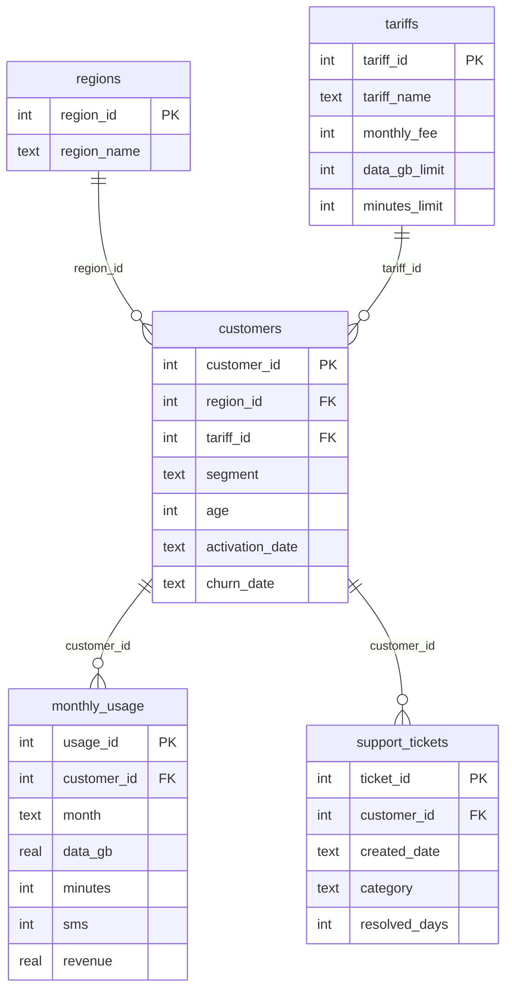

# 📊 Telecom SQL Analytics

SQL-проект по анализу данных телеком-оператора: качество данных, выручка и ARPU, отток клиентов, Парето-анализ сегментов и когортный retention.

**Стек:** SQL (SQLite; запросы переносимы на PostgreSQL с минимальными правками), Python (только для генерации данных).
**Навыки:** `JOIN`, `GROUP BY`, `HAVING`, CTE, подзапросы, оконные функции (`ROW_NUMBER`, `LAG`, `SUM() OVER`), `CASE`, представления, проверки качества данных.

> Данные синтетические: сгенерированы скриптом, к реальным клиентам отношения не имеют. В них намеренно добавлены «грязные» записи (дубликаты, пропуски, выбросы, нелогичные даты), чтобы показать процесс проверки и очистки.

---

## 🗂 Модель данных



Подробное описание полей и метрик: [`docs/data_dictionary.md`](docs/data_dictionary.md).

| Таблица | Строк |
|---|---|
| customers | 5 000 |
| monthly_usage | 46 418 |
| support_tickets | 2 763 |
| tariffs / regions | 4 / 8 |

---

## 🚀 Как запустить

```bash
git clone <repo-url> && cd telecom-sql-analytics
python scripts/generate_data.py   # создаёт data/telecom.db и CSV (Python 3, без доп. библиотек)
python scripts/run_queries.py     # выполняет все запросы, пишет docs/results.md
```

Либо открой `data/telecom.db` в DBeaver / DB Browser for SQLite и запускай файлы из `sql/` по порядку. CSV-файлы в `data/` можно загрузить в Excel или Power BI.

---

## 🧱 Структура

```
sql/
  00_schema.sql            -- DDL: таблицы, ключи, индексы
  01_data_quality.sql      -- проверки качества данных
  02_clean_views.sql       -- очищенные витрины clean_usage, clean_customers
  03_revenue_arpu.sql      -- выручка, ARPU, апсейл
  04_churn.sql             -- отток
  05_pareto_segments.sql   -- Парето и концентрация выручки
  06_retention_cohorts.sql -- когортный retention
scripts/                   -- генерация данных и запуск запросов
docs/                      -- словарь данных, результаты запросов
data/                      -- SQLite-база и CSV
```

---

## 🔍 Бизнес-вопросы и ключевые выводы

### 1. Насколько данные пригодны для анализа? (`01_data_quality.sql`)

Найдены и устранены проблемы:

| Проблема | Измерение | Найдено |
|---|---|---|
| Пропуски в `revenue` | Completeness | 12 строк |
| Дубли «клиент + месяц» | Uniqueness | 15 пар |
| Отрицательный трафик | Validity | 10 строк |
| Выбросы трафика (> 1000 ГБ) | Validity | 3 строки |
| Возраст 0, 5, 150, 999 | Validity | 8 клиентов |
| Отключение раньше подключения | Consistency | 5 клиентов |

При очистке отбрасывается **0,09 %** строк использования. Правила зафиксированы в представлениях `clean_usage` и `clean_customers`, дальнейший анализ строится на них.

### 2. Как растут выручка и ARPU? (`03_revenue_arpu.sql`)

- Выручка за 2025 год: **211,3 млн тенге**, платящих абонентов 4 993.
- Выручка растёт каждый месяц: с 15,5 млн в январе до 19,3 млн в декабре (+25 %). Темп замедляется: с +4 % в феврале до +1,2 % в декабре.
- Месячный ARPU вырос с 4 436 до 4 661 тенге.
- Больше всего выручки приносит **Комфорт** (66,9 млн), хотя клиентов у него почти вдвое меньше, чем у «Эконома» (1 034 против 1 774). «Эконом» даёт 31,7 млн.
- Превышение лимитов почти не увеличивает чек: ARPU выше абонплаты всего на 0,8–3,9 %. Клиентов с постоянным превышением интернета (3+ месяцев) можно перевести на старший тариф, запрос для списка кандидатов есть.

### 3. Кто и почему уходит? (`04_churn.sql`)

- Месячный churn rate стабилен: **около 2,0–2,5 %** (январь 0,24 % не показателен, см. ограничения).
- Churn сильно зависит от тарифа: **Эконом 26,4 %**, Стандарт 19,6 %, Комфорт 12,5 %, Премиум 5,7 %. У дешёвого тарифа отток в 4,6 раза выше, чем у премиального.
- Возраст почти не влияет: 18–21 % во всех группах.
- Обращения в поддержку: у клиентов с 3+ обращениями churn ниже (11,7 % против 20,7 % у клиентов без обращений). Это эффект выживаемости: обращения возможны только пока клиент активен, поэтому чем дольше клиент с нами, тем больше у него шансов обратиться. Вывод «поддержка снижает отток» отсюда делать нельзя, нужно сравнивать клиентов с одинаковым сроком жизни.

### 4. Какие сегменты дают 80 % выручки? (`05_pareto_segments.sql`)

- Из 32 сегментов (регион × тариф) **19 дают 80 %** выручки. Концентрация умеренная.
- Топ-3: Алматы/Комфорт (9,4 %), Алматы/Стандарт (8,8 %), Астана/Комфорт (7,8 %).
- **23,6 %** клиентов приносят половину выручки.

### 5. Как удерживаются новые клиенты? (`06_retention_cohorts.sql`)

- Из клиентов, подключённых в 2025 году, через 5 месяцев остаются **86–93 %**.
- Самая слабая когорта: июльская (86,5 % на 5-м месяце).

---

## 💡 Рекомендации (как для бизнеса)

1. **Удержание на тарифе «Эконом».** Здесь самый высокий отток (26 %). Стоит проверить программы лояльности и предложения апгрейда: переход на «Стандарт» даёт вдвое больший ARPU и на 7 п.п. меньший churn.
2. **Апсейл по факту использования.** Клиентам, 3+ месяца превышающим лимит, предлагать следующий тариф вместо оплаты перерасхода.
3. **Мониторинг качества данных.** Проверки из `01_data_quality.sql` стоит запускать регулярно, особенно на дубликаты по бизнес-ключу.
4. **Углубить анализ обращений.** Сравнивать churn при одинаковом сроке жизни клиента, чтобы убрать эффект выживаемости.

---

## ⚠️ Ограничения

- Данные синтетические, поэтому закономерности (например, зависимость churn от тарифа) заданы генератором. Цель проекта: показать подход, а не открыть реальные инсайты.
- Данные начинаются с января 2025, поэтому в январе churn занижен: отток возможен только у клиентов, которые уже имели начисления.
- Декабрь исключён из расчёта churn: отключения после 31 декабря в данных не видны.

## 🔭 Что можно добавить

- Дашборд в Power BI на CSV из `data/` (выручка, ARPU, churn по регионам и тарифам).
- Python-ноутбук: модель прогноза оттока.
- Проверка гипотезы (t-тест) о разнице ARPU между B2B и B2C.
